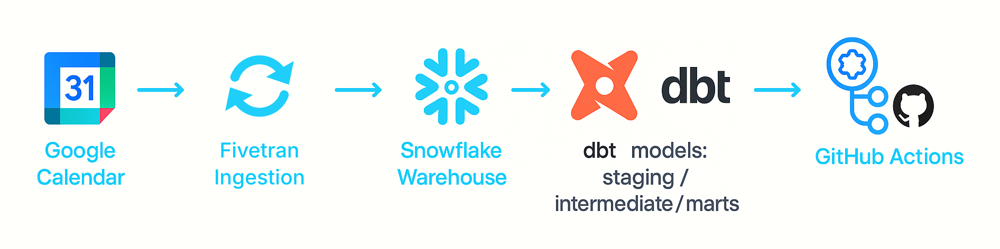

# Google Calendar Analytics Pipeline (dbt + Snowflake + GitHub Actions)

A complete end-to-end analytics engineering project built with **dbt**, **Snowflake**, and **GitHub Actions**.  
The pipeline transforms raw Google Calendar event & attendee data into structured analytical marts
for reporting, automation, and trend analysis.

---

## Architecture Overview

<p align="center">
  
</p>

This diagram shows the full analytics pipeline:

- **Google Calendar** — source of events and attendees  
- **Fivetran** — Google Calendar connector, syncs into Snowflake every 6 hours
- **Snowflake** — cloud data warehouse (raw + staging + analytics schemas)  
- **dbt Core** — transformations (staging → intermediate → marts), tests, documentation  
- **GitHub Actions** — CI/CD orchestration for manual `dbt build` runs  

---

## Project Overview

This project demonstrates a **production-ready data transformation workflow**, including:

- dbt for SQL modeling, testing & documentation  
- Snowflake as a cloud data warehouse  
- GitHub Actions for `dbt build` runs (manual trigger)  
- Google Calendar API as the raw data source  
- Multi-layer dbt architecture (staging → intermediate → marts)  

The pipeline extracts raw events & attendee metadata and turns them into insights such as:

- Daily & weekly event distributions  
- Number of attendees per event  
- Attendee status trends  
- Calendar usage patterns  
- Event-level analytical mart for reporting  

[Project artifacts](/artifacts.md)

---

## Dataset

The project uses exported data from the **Google Calendar API**, loaded into Snowflake via external tools.

### **Source tables (raw → staging):**

- `STG_EVENTS`
Contains event metadata such as title, start/end timestamps, description, event status, and calendar ID.

- `STG_ATTENDEE`
Contains attendee-level data: email, status, organizer flag, optional flags, etc.

- `STG_CALENDAR`
Contains metadata about user's calendars (name, color, visibility).

---

## Project Structure (dbt)

9 models: 3 staging, 1 intermediate, 5 marts.

```text
project_google_calendar_dbt/
│
├── .github/
│   ├── assets/                            # screenshots for README / artifacts.md
│   └── workflows/
│       └── dbt_prod.yaml                  # manual dbt build (workflow_dispatch)
│
├── analyses/
├── macros/
├── models/
│   ├── staging/
│   │   ├── google_calendar_sources.yml    # sources: EVENT, ATTENDEE, CALENDAR_LIST
│   │   ├── schema.yml                     # tests
│   │   ├── stg_attendee.sql
│   │   ├── stg_calendar.sql
│   │   └── stg_events.sql
│   │
│   ├── intermediate/
│   │   └── int_events_with_attendees.sql
│   │
│   └── marts/
│       ├── attendees_status_summary.sql
│       ├── calendar_events_summary.sql
│       ├── event_attendees_daily.sql
│       ├── events_activity_over_time.sql
│       ├── events_daily_summary.sql
│       └── schema.yml                     # descriptions + tests
│
├── seeds/
├── snapshots/
├── tests/
│
├── .gitignore
├── artifacts.md
├── dbt_project.yml
└── README.md
```
---

## CI/CD Overview

CI/CD workflow powered by **GitHub Actions** (`.github/workflows/dbt_prod.yaml`), used to run dbt transformations,
validate data quality, and deploy analytics models to **Snowflake**. Triggered manually.

## Workflow Summary
- Installs dbt runtime and dependencies  
- Generates `profiles.yml` securely using GitHub Secrets  
- Runs `dbt deps` (skipped if no `packages.yml`)  
- Runs `dbt build` (models + tests)  
- Publishes transformed datasets to Snowflake  

## Schedule
| Trigger | Value |
|--------|--------|
| Manual trigger (`workflow_dispatch`) | ✔️ |
| Scheduled cron | — |

## Purpose
Reproducible `dbt build` (models + tests) against Snowflake from a clean runner.

---

## Data Tests

9 dbt generic tests (`not_null`, `unique`), run as part of `dbt build`.

| Model | Column | Tests |
|-------|--------|-------|
| `stg_events` | `event_id` | `not_null`, `unique` |
| `stg_attendee` | `event_id` | `not_null` |
| `calendar_events_summary` | `EVENT_ID` | `not_null`, `unique` |
| `calendar_events_summary` | `EVENT_START_AT` | `not_null` |
| `attendees_status_summary` | `ATTENDEE_EMAIL` | `not_null`, `unique` |
| `events_activity_over_time` | `activity_day` | `not_null` |

## Location
- `models/staging/schema.yml`
- `models/marts/schema.yml`

## Purpose
Catches missing keys and duplicate grain in staging and marts before downstream use.

---

## Roadmap
- `relationships` test: `stg_attendee.event_id` → `stg_events.event_id`
- Grain test for `int_events_with_attendees` (unique event_id + attendee email)
- Incremental history for events & attendees   
- Automated anomaly-detection alerts in the pipeline  

## Vision
Build a scalable, production-grade analytics ecosystem around Google Calendar data.

---

## Project Status

- CI workflow history was cleaned up after stabilizing the pipeline.
- The workflow is kept as a reproducible, manual-run portfolio artifact.
